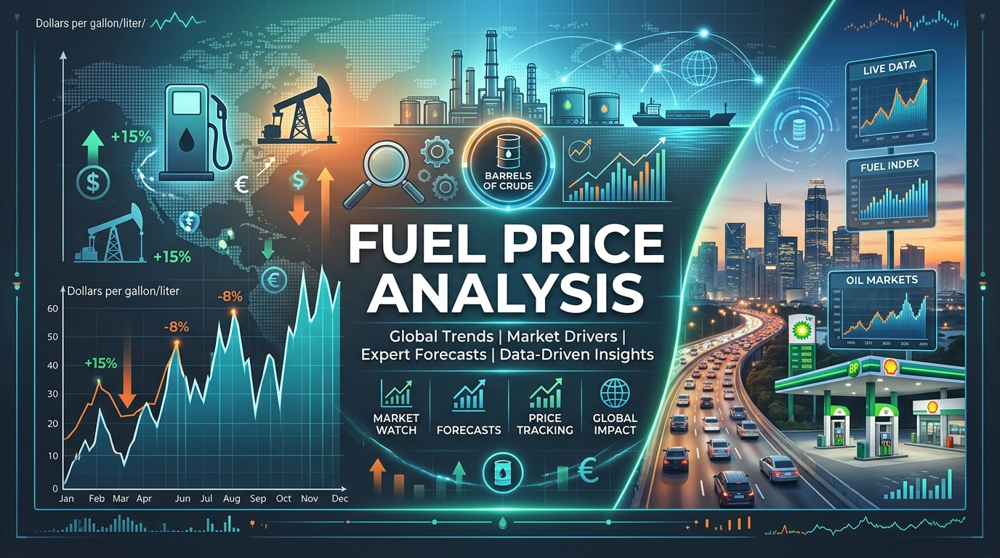
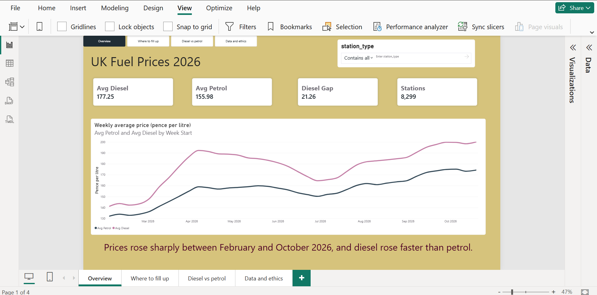
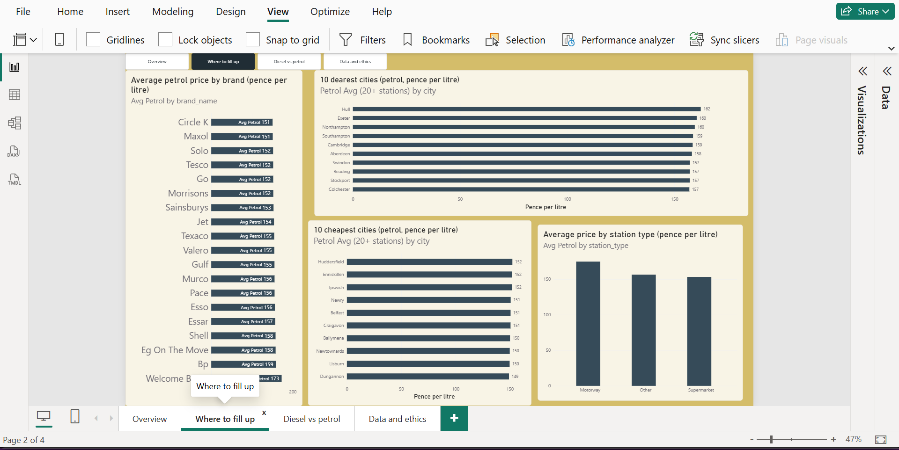
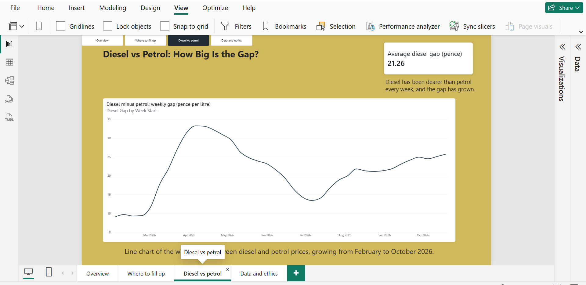
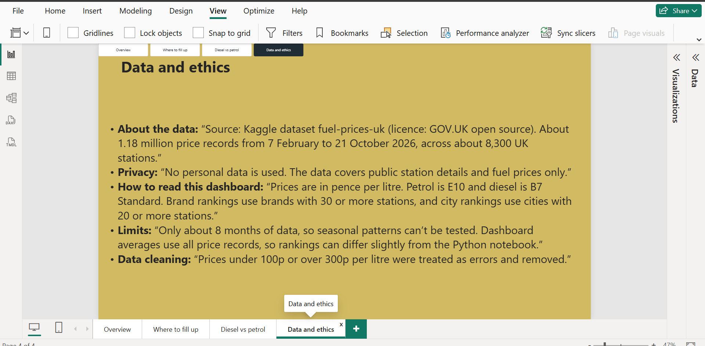

# ⛽ UK Fuel Prices Analytics


### Python & Power BI project showing how UK petrol and diesel prices changed in 2026, and where drivers can pay less.

## 🔗 Live Dashboard

- 📊 [View the Power BI dashboard](https://app.powerbi.com/view?r=eyJrIjoiYmZmOGQxOTMtZDg4ZS00YTg4LTk5YzAtNDVlN2E1ZGY3NzliIiwidCI6ImMyMzNjMDcyLTEzNWItNDMxZC1hZjU5LTM1ZTA1YmFiZjk0MSIsImMiOjh9)

## 📑 Table of Contents

- [Overview](#-overview)
- [Project Structure](#-project-structure)
- [Dataset Content](#-dataset-content)
- [Business Requirements](#-business-requirements)
- [Hypotheses and Results](#-hypotheses-and-results)
- [Project Plan](#-project-plan)
- [ETL](#-data-cleaning-etl)
- [Visualisation Rationale](#-rationale-mapping-business-requirements-to-visualisations)
- [Analysis Techniques](#-analysis-techniques)
- [Ethics, Privacy and GDPR](#-ethics-privacy-and-gdpr)
- [Dashboard Design](#-dashboard-design)
- [Key Findings](#-key-findings)
- [Challenges and Reflection](#-challenges-and-reflection)
- [Unfixed Bugs](#-unfixed-bugs)
- [Development Roadmap](#-development-roadmap)
- [Deployment](#-deployment)
- [Technologies](#-technologies-used)
- [Credits](#-credits)
- [Acknowledgements](#-acknowledgements)

---

## 📌 Overview

- 🎯 **Purpose:** help UK drivers and small fleets understand fuel price trends and find cheaper ways to fill up
- 👥 **Audience:** drivers and fleet managers (non-technical) and analysts (technical)
- ⚖️ **Ethics:** considered in every stage. Each notebook has an ethics note, and the full review is in the Ethics section
- 🧪 **Method:** ETL and EDA in Python (Jupyter), then an interactive Power BI dashboard
- 📈 **Scope:** exploratory analysis only. No machine learning is used
- 🗓️ **Data period:** 7 February to 21 October 2026.

---

## 📁 Project Structure

```
fuel-prices-uk/
├── dashboards/
│   └── fuel_prices_dashboard_v1.pbix
├── data/
│   ├── raw/
│   │   ├── price_history.csv
│   │   └── stations.csv
│   └── cleaned/
│       └── v1/
│           ├── prices_cleaned.csv
│           └── stations_cleaned.csv
├── images/
├── jupyter_notebooks/
│   ├── 01_ETL.ipynb
│   └── 02_Analysis_Visualization.ipynb
├── .gitattributes
├── .gitignore
├── README.md
└── requirements.txt
```

- 📂 Cleaned data is saved in a versioned folder (`v1`) so later changes can be tracked
- 📦 CSV files in `data/` are stored with Git LFS because they are over GitHub's 100 MB limit

---

## 📊 Dataset Content

- 🔗 Source: Kaggle dataset **fuel-prices-uk** (licence: GOV.UK open source). I found it through the Kaggle notebook [UK Fuel Costs Data Exploration](https://www.kaggle.com/code/jamesb7/uk-fuel-costs-data-exploration/notebook)
- ⛽ **price_history.csv:** about 1.18 million price records (`node_id`, `fuel_type`, `price_pence`, `recorded_at`)
- 🏪 **stations.csv:** 8,503 stations (`brand_name`, `city`, `latitude`, `longitude`, `is_motorway`, `is_supermarket` and more)
- 🔑 The two files link on `node_id`
- ⛽ Fuel types: E10 and E5 (petrol), B7 Standard and B7 Premium (diesel), plus a very small number of HVO and B10 records
- ✅ After cleaning: about 1.18 million price records across about 8,300 stations

---

## 💼 Business Requirements

- 🎯 **Scenario:** a UK motoring information service wants clear, data-backed advice on fuel costs
- 📈 **BQ1:** How have petrol and diesel prices changed over time?
- 🏷️ **BQ2:** Which brands are cheapest, and are supermarkets cheaper?
- 🛣️ **BQ3:** How much more do motorway stations charge?
- 🗺️ **BQ4:** Which cities pay the most and least?
- ⛽ **BQ5:** What is the gap between diesel and petrol?

---

## 🧪 Hypotheses and Results

| # | Hypothesis | Result | Evidence |
|---|-----------|--------|----------|
| H1 | Diesel is priced above petrol | ✅ Supported | Diesel dearer in all 38 weeks; gap grew from 9p to 26p |
| H2 | Supermarkets are cheaper than other stations | ✅ Supported | About 2.7p cheaper (petrol) and 3.1p cheaper (diesel) |
| H3 | Motorway stations charge a premium | ✅ Supported | About 17p more (petrol) and 14p more (diesel) |
| H4 | Prices differ by region | ✅ Supported | 7 of the 8 cheapest cities are in Northern Ireland; Exeter is dearest; about 13p spread |

- 📝 Hypotheses were validated using visual and comparative analysis, not formal statistical tests

---

## 🗓️ Project Plan

- 📋 Planned and tracked with a [GitHub Project Board](https://github.com/users/hemacbaker-byte/projects/7/views/1) (Backlog, In Progress, Done)

**Phases**

1. 🧭 **Scoping and ethics:** business questions, ethics and GDPR checks
2. 🛠️ **Setup:** repository, folders, Git LFS
3. 🧹 **ETL:** clean, join and save data to `data/cleaned/v1/`
4. 📊 **EDA:** answer BQ1 to BQ5 and test hypotheses
5. 📈 **Dashboard:** build and publish in Power BI
6. 🔍 **Evaluation:** check results against the business requirements and the assessment criteria
7. 📝 **Documentation:** README, credits, final submission
8. 🔄 **Maintenance and updates (future):** download newer price data, re-run the notebooks, save outputs in `v2`, refresh the dashboard and re-check results

---

## 🧹 Data Cleaning (ETL)

- 🗑️ Removed 1,184 impossible prices (under 100p or over 300p per litre)
- 🔁 Checked for duplicates (none found)
- 🕒 Converted date text to real dates
- 🏷️ Grouped fuel types into Petrol, Diesel and Other
- 🧽 Dropped empty or unneeded station columns and permanently closed stations
- 🔤 Fixed city name duplicates (for example `BELFAST` and `Belfast`)
- ❓ Kept missing brands and cities as "Unknown" instead of guessing
- 💾 Saved two linked tables to `data/cleaned/v1/`

---

## 🎨 Rationale: Mapping Business Requirements to Visualisations

| Business Question | Visual | Why |
|---|---|---|
| BQ1 Price over time | Line chart | Shows trends and peaks clearly |
| BQ2 Brands | Horizontal bar chart | Easy to rank and compare brands |
| BQ3 Motorway premium | Grouped column chart | Compares station types side by side |
| BQ4 Cities | Two bar charts (10 cheapest and 10 dearest) | Shows regional differences |
| BQ5 Diesel gap | Area/line chart | Shows how the gap changes |


---

## 🛠️ Analysis Techniques

- 🧹 **ETL:** cleaning, filtering, joining and grouping with pandas
- 📊 **EDA:** weekly averages, group comparisons, ranking
- ⚖️ **Fair comparisons:** averages are taken per station first, so busy stations do not count more than quiet ones
- 🎨 **Visualisation:** matplotlib and seaborn in notebooks, Power BI for the dashboard
- 🤖 **Generative AI:** Claude was used for ideas, structure and code debugging.

---

## ⚖️ Ethics, Privacy and GDPR

- 🔒 **Personal data:** none found. The data is public station information and fuel prices. No customers or drivers are identified. Small independent stations could be sole traders, so the risk is low but not zero; station names and postcodes are not used in any analysis or chart
- 📜 **UK GDPR:** assessed as not applicable, because no personal data about people is processed. Business details such as station name and address are public
- 📄 **Licence:** the dataset licence was checked on Kaggle: GOV.UK open source (as stated for the dataset) and is credited below
- 🧮 **Assumption:** prices under 100p or over 300p per litre were treated as errors (1,184 rows removed). This is a judgement call and is documented in the ETL notebook
- 🏛️ **Governance:** the data source and licence are credited. Raw data is kept unchanged in `data/raw/`, and cleaning steps are documented and repeatable
- ⚖️ **Fairness and bias:**
  - Cities with few stations (under 20) were excluded from rankings to avoid misleading averages
  - Prices vary by area for reasons such as rural costs and competition, so results are not blame on any station or place
- 🌍 **Social impact:** fuel costs affect people on low incomes and rural drivers most. Findings are shared to help them save money
- 🚫 **Responsible use:** the analysis describes the past. It should not be used to set prices unfairly or to predict future prices.

---

## 🖥️ Dashboard Design

- 🏠 **Page 1 Overview:** KPI cards, weekly price line chart, station type filter (BQ1)
- 🏷️ **Page 2 Where to fill up:** brands, station type, 10 cheapest and 10 dearest cities (BQ2 to BQ4). Brand chart: Supermarkets are about 3p cheaper per litre.
Station-type chart: Motorway stations cost 14p to 17p more per litre.
- ⛽ **Page 3 Diesel vs petrol ("How big is the gap?"):** weekly gap line chart and KPI card (BQ5)
- ⚖️ **Page 4 Data and ethics:** source, licence, no personal data, limitations (8 months of data, uneven stations per city), how to read the dashboard.

**Communicating to different audiences**

- 🧑‍🤝‍🧑 **Non-technical:** plain-English notes on each page, clear titles, simple charts
- 🔬 **Technical:** station counts, averages in pence per litre, notes on how the numbers were calculated
- ♿ **Accessibility:** high-contrast colours, large text, alt text on visuals, consistent layout and navigation buttons.

**Dashboard screenshots**

| Page | Screenshot |
|---|---|
| 1 Overview |  |
| 2 Where to fill up |  |
| 3 Diesel vs petrol |  |
| 4 Data and ethics |  |

---

## 🔍 Key Findings

- 📈 **Prices rose strongly:** petrol went from 140p to 181p (+29%) and diesel from 149p to 206p (+38%) between February and October 2026, with both peaking in early October.
- ⛽ **Diesel is always dearer:** the gap grew from 9p to 26p.
- 🛒 **Supermarkets are cheaper:** about 3p per litre below other stations. Maxol and Tesco have the lowest petrol prices.
- 🛣️ **Motorways cost more:** about 14p to 17p extra per litre.
- 🗺️ **Location matters:** about 13p spread between cities, with Northern Ireland cheapest.
- 💼 **Advice:** use supermarket stations, avoid motorway stops, and fleets should plan for faster diesel increases.

---

## 💭 Challenges and Reflection

- 📦 **Large files:** the raw data was over GitHub's 100 MB limit, so I used Git LFS and saved smaller cleaned files
- 🧹 **Bad data:** some prices were impossible (such as 0p or over 2,000p) and city names had different capitalisation. I fixed both in the ETL.
- 🔗 **Two tables:** keeping prices and stations as linked tables worked better in Power BI than one huge file.
- 🗓️ **Short time period:** only about 8 months of data, so seasonal patterns cannot be tested
- 🧮 **Power BI vs Python:** the notebook averages each station first, while Power BI averages all price records, so city and brand rankings differ slightly (for example Exeter is about 164p in the notebook and about 160p in Power BI, and Hull appears in the Power BI top 10). Power BI also uses only E10 (petrol) and B7 Standard (diesel), while the notebook groups all petrol and all diesel. Both methods are documented so results can be compared
- 🧠 **What I learned:** plan the folder structure early, make small commits, and check data quality before analysing.

---

## 🐞 Unfixed Bugs

- No known bugs stop the notebooks from running!
- Some cities appear with small differences in spelling that were not caught, and small cities are excluded from rankings.

---

## 🗺️ Development Roadmap

- 🔄 Add newer data and compare months.
- 📅 Test seasonal and weekday patterns when more data is available.
- 🗺️ Add region groupings (for example England, Scotland, Wales, Northern Ireland).
- 📊 Add an interactive "cheapest stations near me" page.

---

## 🚀 Deployment

- 📊 Dashboard published to the web with Power BI Service ([link](https://app.powerbi.com/view?r=eyJrIjoiYmZmOGQxOTMtZDg4ZS00YTg4LTk5YzAtNDVlN2E1ZGY3NzliIiwidCI6ImMyMzNjMDcyLTEzNWItNDMxZC1hZjU5LTM1ZTA1YmFiZjk0MSIsImMiOjh9))
- 📥 The Power BI file is also in `dashboards/`, so it can be opened in Power BI Desktop
- 💻 Code and data stored in this GitHub repository.

**Run it yourself**

```
git clone https://github.com/hemacbaker-byte/fuel-prices-uk.git
cd fuel-prices-uk
git lfs pull
pip install -r requirements.txt
```

- ▶️ Run the notebooks in order: `01_ETL.ipynb` then `02_Analysis_Visualization.ipynb`

---

## 🧰 Technologies Used

- 🐍 **Python:** pandas, numpy, matplotlib, seaborn
- 📓 **Jupyter Notebooks** in VS Code
- 📊 **Power BI** for the dashboard
- 🌿 **Git, GitHub and Git LFS** for version control

---

## 🙏 Credits

- 📊 Dataset: Kaggle **fuel-prices-uk** (found through the Kaggle notebook [UK Fuel Costs Data Exploration by jamesb7](https://www.kaggle.com/code/jamesb7/uk-fuel-costs-data-exploration/notebook))
- 📚 [Code Institute](https://codeinstitute.net/): learning material and README and notebook templates.
- 🤖 Claude (Anthropic): ideas, structure, code debugging,readme.
- 📖 Documentation for pandas, matplotlib and seaborn.
-visualization (PowerBI).

## 🤝 Acknowledgements

- Thanks to my Code Institute tutors vasi & Emma and mentors for their guidance and feedback.